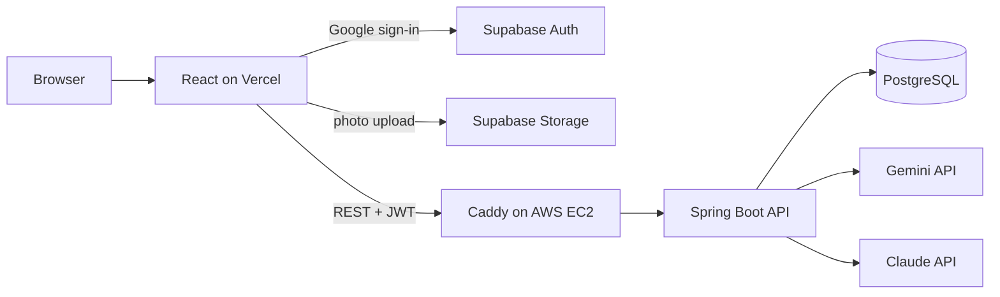

# Mutabilis

I designed this skincare tracker as at a certain point it felt like my skin would never get better due to my acne as it always appeared randomly and I could never figure out why it was happening. This caused insecurities but I built this skincare tracker app based on my own needs and it helps you find out what affects your skin. It helps users be more confident and less in the dark about their own skin. For example, for me I found out that protein shakes cause acne for some individuals such as myself due to its ingredients. You log daily face photos, routines and lifestyle habits, and AI scores your photos and answers questions about patterns in your own data.

**Live:** [getmutabilis.com](https://getmutabilis.com)

DEMO:
https://github.com/user-attachments/assets/aded8ea8-c3d4-47fe-8498-1a8c5641e82a

## Features

- **Daily entries:** left, middle and right face photos, a diary, sleep, water and stress.
- **Routines:** build AM/PM routines with fuzzy product search.
- **AI photo scoring:** Gemini scores each day's photos for acne, redness and texture.
- **Ask about your skin:** a Claude chatbot compares selected days, looking back 7 days to catch delayed reactions.
- **Calendar view:** a month of photos at a glance, with multi-day selection for comparison.

## Tech stack

| Layer | Tech |
|---|---|
| Frontend | React, Vite, deployed on Vercel |
| Backend | Java, Spring Boot, Spring Security |
| Database | PostgreSQL (`pg_trgm` for fuzzy search) |
| Auth and storage | Supabase (Google OAuth, private storage buckets) |
| AI | Google Gemini API (photo scoring), Anthropic Claude API (chat, product lookup) |
| Infrastructure | Docker Compose on AWS EC2, Caddy for HTTPS |

## Architecture

## How it works

- **Authentication:** users sign in with Google through Supabase. The API verifies the ES256-signed JWT on every request using Supabase's public keys (JWKS), and takes the user ID from the token, so users can only access their own data.
- **Product search:** typo-tolerant search with PostgreSQL trigram similarity and a GIN index. If a product isn't found, Claude identifies it with structured JSON output and it is saved to the database, so later searches don't call the API again.
- **Photo scoring:** photos are resized in the browser, uploaded to a private bucket, and scored by Gemini using a JSON schema so the results are always structured.
- **Chat:** the API gathers scores, lifestyle data, routines, product ingredients and diary entries for the selected days and the 7 days before them, and sends them to Claude as context.

## Author

(https://github.com/desmonddayan)
